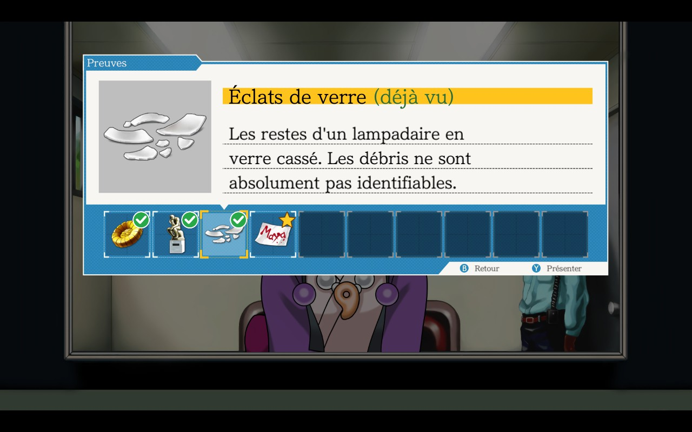

# Ace Attorney Trilogy: Evidence Tracker

A small quality-of-life mod for **Phoenix Wright: Ace Attorney Trilogy** (Steam, PC and Steam Deck).

During **investigations**, when you open the Court Record to **present** something to a character, the mod marks the evidence and profiles you have already shown to that character:

| Mark | Meaning |
|---|---|
| Green check badge + **(shown)** | Already presented to this character, and they would give you **the same answer** again. No need to try it a third time. |
| Gold star badge + **(new!)** | Already presented, but **the answer has changed** since: the story moved on and a new dialogue is unlocked. Worth trying again! |
| No badge | Never presented to this character. |

The answer is computed **without playing it**, from the same table the game uses (`tantei_show_check`), so the marks follow the game's own logic: an item that did nothing earlier gets a star as soon as it unlocks something. A character keeps their history when they move to another location.

Court phases and simply browsing the Court Record are not affected.



### History follows your save

- The history is kept with **your save slot**: saving writes it next to the slot, loading brings it back.
- **New game** (or episode select) starts with an empty history.
- Quitting without saving loses the presentations made since the last save, exactly like the rest of your progress.
- `Ctrl+F10` clears the history of the current chapter (for the game in progress).

Labels are shown in the game's language (English, French, German, Japanese, Korean, Chinese simplified/traditional, Brazilian Portuguese, Latin American Spanish).

## Installation

Requires **[BepInEx 5](https://github.com/BepInEx/BepInEx/releases)** (tested with 5.4.23.6).
The game is a **32-bit** build: use **`BepInEx_win_x86_5.4.23.x.zip`** (the x64 package will not load).

### Windows

1. Extract `BepInEx_win_x86_5.4.23.x.zip` into the game folder (the one containing `PWAAT.exe`).
2. Extract this mod's zip into the same folder: it only adds `BepInEx/plugins/PWAAT_QoL.dll`.
3. Start the game.

### Steam Deck / Linux (Proton)

1. Same two steps as Windows (the game runs through Proton, so it is still the **Windows x86** BepInEx).
2. In Steam: game **Properties → General → Launch Options**, paste:
   ```
   WINEDLLOVERRIDES="winhttp=n,b" %command%
   ```

### Uninstall

Delete `BepInEx/plugins/PWAAT_QoL.dll` (and the `BepInEx/config/pwaat_qol` folder for the history). Remove `BepInEx`, `winhttp.dll` and `doorstop_config.ini` to drop BepInEx entirely.

## Configuration

`BepInEx/config/wheekz.pwaat.qol.cfg` (created on first launch):

| Setting | Default | |
|---|---|---|
| `MarquerPresentations` | `true` | Enable the marks. |
| `ToucheRemiseAZero` | `F10 + LeftControl` | Clear the current chapter's history. |
| `Journal` | `false` | Verbose log in `BepInEx/LogOutput.log` (for bug reports). |

## Known limitations

- A few answers branch internally on story flags. In rare cases a "(shown)" item could still produce a slightly different line.
- The history is stored locally (`BepInEx/config/pwaat_qol/slot_N.txt`): it is **not** synced by Steam Cloud with your saves. Copy that folder if you move between PC and Steam Deck.

## Building

.NET SDK (any recent version), then:

```
dotnet build -c Release
```

Edit `GameDir` in `PWAAT_QoL.csproj` to point to your install; the DLL is copied to `BepInEx/plugins` automatically. `package.ps1` builds the release zip.

## License

MIT, see [LICENSE](LICENSE). This mod contains no game files; Phoenix Wright: Ace Attorney is © CAPCOM.

---

## 🇫🇷 En bref

En **enquête**, quand tu ouvres le dossier pour **présenter** quelque chose à un personnage, le mod marque ce que tu lui as déjà montré : **coche verte + (déjà vu)** = même réponse qu'avant ; **étoile dorée + (nouveau !)** = la réponse a changé, un nouveau dialogue est débloqué. L'historique suit **ta sauvegarde** (nouvelle partie = vierge). Installation : BepInEx 5 **x86**, puis la DLL dans `BepInEx/plugins` ; sur Steam Deck, ajouter `WINEDLLOVERRIDES="winhttp=n,b" %command%` aux options de lancement.
